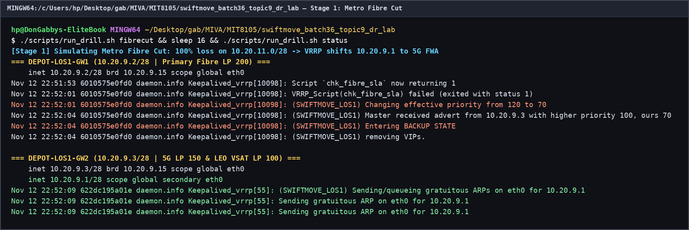
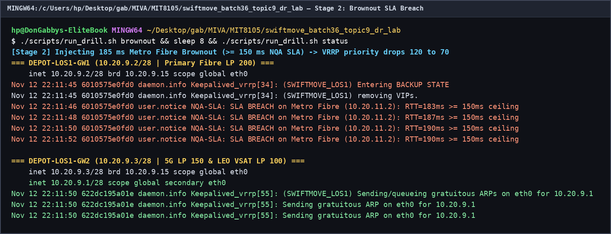
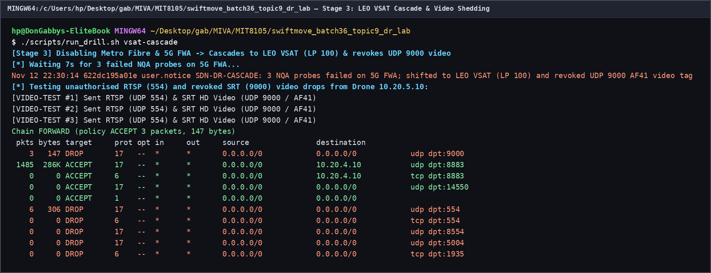
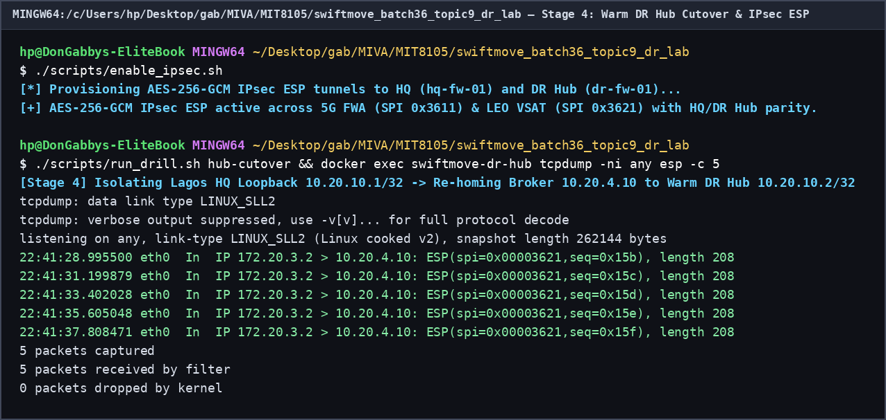

# SwiftMove Nigeria Ltd. DR Connectivity Lab

## MIT 8105 · Batch 36 · Topic 9

This repository is a containerized **logical proof of concept** for a SwiftMove Lagos-1 depot disaster-recovery (DR) network. It exercises routing, gateway failover, WAN impairment, traffic filtering, telemetry continuity, hub cutover, and optional IPsec ESP using Linux network namespaces. It is intended for learning and design discussion—not as deployable production configuration or proof of physical-network performance.

## Purpose and design rationale

The lab makes a multi-link DR design observable and repeatable without access to carrier circuits or router hardware. It lets engineers rehearse failure scenarios, inspect control-plane and forwarding behavior, and discuss requirements that need validation before a physical implementation.

The conceptual path is **Metro Fibre → 5G FWA → LEO VSAT**, with a local VRRP virtual gateway and separate HQ and warm-DR hub destinations. The topology and boundaries are described in [Logical design](docs/logical-design.md); the gaps and production-readiness requirements are in [Prototype limitations](docs/prototype-limitations.md).

## What is included

| Path | Purpose |
| --- | --- |
| [`compose.yml`](compose.yml) | Docker Compose topology |
| [`swiftmove-b36-dr.clab.yml`](swiftmove-b36-dr.clab.yml) | Containerlab topology |
| [`scripts/`](scripts/) | Linux node initialization, DR drills, telemetry probe, and optional IPsec setup |
| [`configs/huawei_vrp_batch36_baseline.cfg`](configs/huawei_vrp_batch36_baseline.cfg) | Separate Huawei VRP reference; not loaded by either container topology |
| [`assets/`](assets/) | Sample drill logs, figures, reference notes, and evidence appendix |
| [`logs/`](logs/) | Bind-mounted output directory for probe CSV and runtime logs |

## Logical address and behavior baseline

| Component | Address / behavior |
| --- | --- |
| Lagos-1 depot edge LAN | `10.20.9.0/28`; edge `10.20.9.10`; VRRP VIP `10.20.9.1` |
| Primary gateway | GW1 `10.20.9.2`; Metro Fibre path |
| DR gateway | GW2 `10.20.9.3`; 5G FWA, then LEO VSAT |
| Synthetic telemetry receiver | `10.20.4.10:8883`; UDP request/acknowledgement probe (not MQTT/TLS) |
| HQ / warm DR hub | `10.20.10.1` / `10.20.10.2` |
| WAN links | Fibre `10.20.11.0/29`; 5G `10.20.11.8/29`; VSAT `172.20.3.0/29` |
| Simulated link profiles | Fibre ~8 ms; 5G ~26 ms; VSAT ~58 ms baseline delay |
| Example threshold | 150 ms RTT; probe and watcher logic are simplified lab checks |

The configured delays, link rates, route changes, VRRP behavior, and firewall counters are **simulated in containers**. They do not represent measured carrier performance or a complete QoS/security policy.

## Requirements

- Docker Engine/Desktop with Compose v2, or Linux/WSL2 with Containerlab and Docker.
- A Linux-compatible shell for the drill scripts (`bash`/`sh`). On Windows, use WSL2 with Docker Desktop integration enabled; Git Bash is also supported.
- Internet access on first startup so the Alpine containers can install packages.

Run commands from the repository root. Create the bind-mounted output directory and, on Linux/WSL2/Git Bash, mark scripts executable:

```sh
mkdir -p logs
chmod +x scripts/*.sh
```

Docker Desktop may report an address-pool overlap if one of the configured subnets conflicts with another Docker network. Resolve the conflicting network/subnet in Docker before starting the lab; do not assume Compose can safely delete unrelated networks.

## Start the lab

Choose one deployment option.

### Option A — Containerlab (Linux / WSL2)

```sh
sudo containerlab deploy -t swiftmove-b36-dr.clab.yml
```

Containerlab node containers use the `clab-swiftmove-b36-dr-` prefix.

### Option B — Docker Compose

```sh
docker compose -f compose.yml up -d
```

Compose container names use the `swiftmove-` prefix.

## Run the four-stage DR drill

Use separate terminals for the continuous telemetry probe and drill commands. The hub containers start UDP acknowledgement receivers automatically. Start a probe from the edge container:

```sh
# Docker Compose
MSYS_NO_PATHCONV=1 docker exec -it swiftmove-edge-los1 python3 /opt/scripts/telemetry_probe.py

# Containerlab (use this instead of the Compose command)
MSYS_NO_PATHCONV=1 docker exec -it clab-swiftmove-b36-dr-edge-los1 python3 /opt/scripts/telemetry_probe.py
```

The probe reports each request's observed round-trip time against a 150 ms threshold and writes CSV to `logs/batch36_quarterly_drill.csv`. It does not calculate p95 statistics, and timeout labels such as `NVME_BUFFER` are reporting text only—not durable buffering or an RPO guarantee. Stop it with `Ctrl+C`.

In another Linux-compatible shell, run the matching commands for each stage:

### Stage 1 — Metro Fibre cut

Restore the baseline, allow the VRRP primary to recover, inject a fibre outage, and inspect gateway status:

```sh
./scripts/run_drill.sh baseline
sleep 32
./scripts/run_drill.sh fibrecut
sleep 8
./scripts/run_drill.sh status
```

### Stage 2 — Fibre brownout

Restore and allow the primary to recover before injecting 185 ms of fibre delay:

```sh
./scripts/run_drill.sh baseline
sleep 32
./scripts/run_drill.sh brownout
sleep 8
./scripts/run_drill.sh status
```

### Stage 3 — 5G failure and VSAT cascade

This disables fibre and 5G, waits for the DR uplink watcher to select VSAT, sends unauthorized-video test packets, and prints GW2 forwarding counters:

```sh
./scripts/run_drill.sh baseline
sleep 32
./scripts/run_drill.sh vsat-cascade
```

### Stage 4 — HQ to warm DR hub route cutover

Restore the WAN baseline and allow the depot gateway to recover. The optional IPsec setup installs lab XFRM security associations using temporary keys generated at runtime. It requires `openssl` or `python3` on the host. You may instead provide valid 36-byte RFC4106 key material through `IPSEC_KEY_5G` and `IPSEC_KEY_VSAT`; do not store those values in the repository:

```sh
./scripts/run_drill.sh baseline
sleep 32

# Optional lab-only ESP demonstration; generates temporary keys
./scripts/enable_ipsec.sh
```

If capturing ESP, start this command in a separate terminal:

```sh
# Docker Compose
docker exec -it swiftmove-dr-hub tcpdump -ni any esp -c 5

# Containerlab (use this instead of the Compose command)
docker exec -it clab-swiftmove-b36-dr-dr-hub tcpdump -ni any esp -c 5
```

Then run the route cutover in the drill terminal while the edge telemetry probe is running:

```sh
./scripts/run_drill.sh hub-cutover
```

`hub-cutover` manually changes the WAN-core route to the warm DR hub; it is not an automated hub-health or application recovery workflow. `run_drill.sh` also accepts `baseline` to restore the normal WAN profile and HQ route, and `status` to display gateway addresses and recent VRRP logs. Allow time for VRRP preemption after restoring the baseline before starting another failover stage.

## Documentation and evidence

- [Logical design](docs/logical-design.md) — intent, topology, failover logic, and design rationale.
- [Prototype limitations](docs/prototype-limitations.md) — what the lab does not model and what a physical design must validate.
- [Evidence appendix](assets/Appendix_APA7_CopyPaste.md) — sample console records and their interpretation.

### Figures

| Stage | Figure |
| --- | --- |
| Fibre cut |  |
| Fibre brownout |  |
| VSAT cascade and filtering |  |
| Hub cutover and ESP |  |

### Sample logs and reference material

- [Stage 1 fibre-cut log](assets/stage1_fibrecut.log)
- [Stage 2 brownout log](assets/stage2_brownout.log)
- [Stage 3 VSAT-cascade log](assets/stage3_vsat_cascade.log)
- [Stage 4 hub-cutover / ESP log](assets/stage4_hub_cutover_esp.log)
- [Huawei VRP prompt block](assets/huawei_vrp_prompt_block.txt)

These are illustrative artifacts from lab runs, not independent acceptance evidence, production SLA results, or proof of regulatory compliance.

## Stop and clean up

```sh
# Docker Compose
docker compose -f compose.yml down

# Containerlab
sudo containerlab destroy -t swiftmove-b36-dr.clab.yml
```

## Important safety note

Do not copy the example configurations directly into a production network. The Linux scripts and Huawei VRP reference require a separate security, platform, addressing, routing, and operational review before any physical implementation. The container VRRP example has no authentication configured; the Huawei reference also omits a shared lab password. Define and validate a suitable control-plane security policy for any real deployment.
