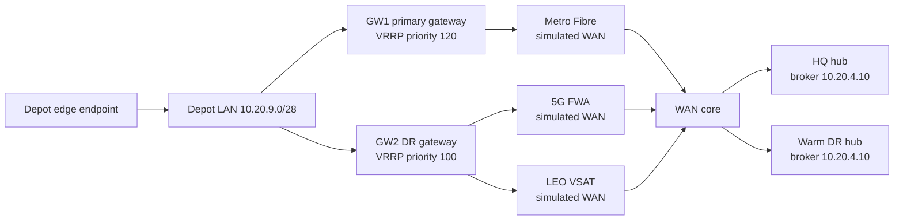
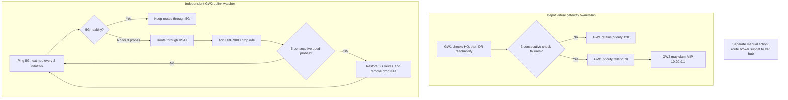

# Logical Design and Engineering Rationale

## Purpose

This project is a **logical DR connectivity prototype** for a depot that must retain network reachability when its preferred WAN service is degraded or unavailable. It is deliberately runnable on a workstation so a network engineer can demonstrate selected failure responses, review route and gateway behavior, and refine requirements before procuring circuits or configuring physical equipment.

The prototype is useful for:

- rehearsing repeatable failure scenarios without affecting a live network;
- making the intended primary/secondary/tertiary WAN preference explicit;
- examining the distinction between local gateway redundancy, WAN path selection, and hub route cutover;
- discussing which service classes should remain available when bandwidth is constrained; and
- creating a starting point for an implementation specification and a hardware-backed test plan.

It is **not** a production design approval, a physical-network emulation, or evidence that the design meets a carrier SLA, recovery-time objective (RTO), recovery-point objective (RPO), or regulatory control.

## Design concept

The logical design has four functional zones:

1. **Depot LAN** — the edge endpoint and two gateways share a LAN segment. Keepalived advertises a virtual IP (`10.20.9.1`) using VRRP.
2. **WAN paths** — GW1 represents the preferred Metro Fibre path. GW2 represents 5G FWA and a tertiary LEO VSAT path. The WAN-core node connects these paths to the hub transit networks and applies simulated delay/loss.
3. **Hub services** — separate HQ and warm DR containers host an acknowledgement receiver on the same logical broker address (`10.20.4.10`). A route change in the WAN core directs traffic to one hub or the other.
4. **Traffic policy and observation** — Linux `iptables`, `tc`, `ip route`, and XFRM commands model selected packet handling and behavior. A Python UDP probe generates synthetic telemetry and records per-request results.

The diagram represents logical roles, not physical equipment or real provider paths. Containerlab and Compose provide different ways to instantiate the same broad set of nodes; their link construction is not identical.

## Logical segments

| Segment / role | Addressing in the container lab | Intent |
| --- | --- | --- |
| Depot LAN | `10.20.9.0/28` | Edge endpoint, GW1, GW2, and the VRRP VIP |
| Fibre transit | `10.20.11.0/29` | GW1 to WAN core |
| 5G transit | `10.20.11.8/29` | GW2 to WAN core |
| VSAT transit | `172.20.3.0/29` | GW2 to WAN core |
| HQ transit | `172.20.1.0/29` in Compose; point-to-point link in Containerlab | WAN core to HQ |
| DR transit | `172.20.2.0/29` in Compose; point-to-point link in Containerlab | WAN core to warm DR |
| Service addresses | `10.20.4.10` broker; `10.20.10.1` HQ identity; `10.20.10.2` DR identity | Example service and hub destinations |

The shared logical broker address is assigned on both hub containers. Route selection determines which instance receives traffic in this lab; a production implementation would need an explicit service identity, state/data replication approach, and ownership/fencing model.

## Failover behavior

The demo has distinct mechanisms; they should not be conflated into one automatic DR controller:

- **Depot gateway ownership:** GW1 runs a Keepalived tracking script that pings the HQ address, falling back to the DR hub address if needed. The check runs every two seconds; after three failures its VRRP priority is reduced by 50. GW2 has priority 100 and can then take the virtual IP. A 150 ms ceiling is checked using a simplified RTT extraction from ping output.
- **5G-to-VSAT routing:** a separate GW2 watcher probes its 5G next hop every two seconds. Three failed or over-threshold probes install routes through VSAT and insert a UDP/9000 drop rule. Five good probes restore 5G and remove that rule.
- **Hub cutover:** the `hub-cutover` drill action manually takes the HQ-side interface down and changes the WAN-core route for `10.20.4.0/24` to the DR hub. The lab does not automatically monitor hub service health or orchestrate application recovery.

The flow is an implementation summary for the current scripts. It is not a vendor-neutral failover standard or a validated convergence-time guarantee.

## Rationale and engineering trade-offs

### Why a containerized logical model

The key question at this stage is whether the recovery concept and the desired operational sequence are coherent—not whether a specific carrier, router, antenna, or optical circuit meets a target. Containers make the failure controls repeatable, reduce the cost of early design iteration, and let engineers inspect route tables, VRRP state, firewall counters, and packet captures.

The abstraction is intentionally economical: Linux networking primitives stand in for functions that a physical design might implement with router protocols, SD-WAN policy, provider CPE, or dedicated firewalls. This enables functional discussion but does not establish feature equivalence.

### Why three WAN tiers

The preferred terrestrial fibre path is paired with an independent 5G path and a tertiary satellite path to prompt analysis of availability, bandwidth, latency, and service prioritization under degradation. The lab encodes example latencies and rates with `tc`; actual values must come from carrier testing and service contracts. Independence is an architectural assumption to verify: shared ducts, power, upstream providers, landing stations, or customer premises can create correlated failures.

### Why separate gateway and hub recovery

VRRP answers a local question: which depot gateway owns the LAN virtual address? WAN route selection answers a different question: which uplink should that gateway use? Hub cutover answers another: where is a service subnet reachable? Keeping these control actions distinct makes operational dependencies visible and avoids implying that local gateway redundancy alone provides end-to-end disaster recovery.

### Why retain a separate Huawei reference

The Huawei VRP file is a conceptual platform-specific translation of selected roles and policies. It is not invoked by Docker Compose or Containerlab. Keeping it separate prevents readers from mistaking a Linux demonstration for a device configuration test. Hardware model, VRP release, syntax, protocol interoperability, and platform-specific behavior all require validation on the intended equipment.

## Suggested physical-design follow-up

Before using this concept as an implementation basis, produce and review:

1. a requirements matrix with service criticality, RTO/RPO, latency/loss targets, and recovery ownership;
2. a verified address plan and routing policy, including return paths, route preference, filtering, and failure-domain boundaries;
3. carrier diversity and power/site dependency evidence for each WAN path;
4. target-hardware configuration and interoperability tests for VRRP, tracking, routing, QoS, ACLs, and IPsec;
5. security design for identity, key exchange/rotation, management access, logging, and default-deny policy;
6. an application-level recovery and data-consistency plan for HQ/DR services; and
7. controlled acceptance tests measuring loss, convergence, application availability, and recovery objectives.

See [Prototype limitations](prototype-limitations.md) for what the current implementation does not prove.
